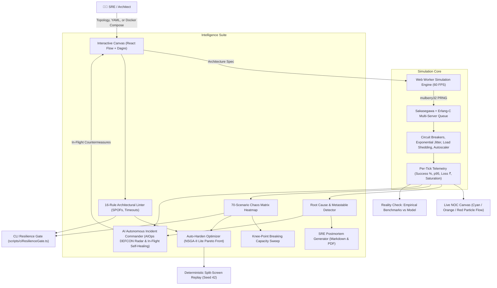

# 🧨 CascadeLab

### A Resilience Digital Twin for Microservices: Simulate, Explain, and Auto-Harden Cascading Failures *Before* Production

[-3178C6.svg?logo=typescript&logoColor=white)](https://www.typescriptlang.org/)
[](https://react.dev/)
[](https://tailwindcss.com/)
[](https://reactflow.dev/)
[](https://vitest.dev/)
[]()
[-38BDF8.svg)]()
[](LICENSE)
[]()
[-brightgreen.svg)]()

---

## ⚡ The Distributed Systems Dilemma

Modern systems (fintech, UPI payment switches, quick-commerce, streaming, ride-hailing) are composed of dozens of interdependent microservices. In production, **catastrophic outages almost never originate from a total host crash**. Instead, they begin with a minor, localized hiccup in a leaf dependency:

```
[External Payment Gateway slows by 5x]
               │
               ▼
[Checkout Service Worker Threads saturate waiting for calls]
               │
               ▼
[Upstream Gateway experiences timeouts and initiates Retries]
               │
               ▼
[Retry Storm multiplies offered load onto struggling services]
               │
               ▼
[Queue Limit reached -> Overload crash loops -> Cascading brownout]
               │
               ▼
[Metastable State: The system stays down even AFTER the gateway heals!]
```

Engineers typically discover these dangerous feedback loops under maximum stress during flash sales, festival spikes, or product launches. Existing chaos testing tools require live, expensive, and risky cloud environments. Architecture diagrams in wikis are static and completely blind to runtime queueing dynamics.

**CascadeLab brings resilience engineering to design time and runtime.** It is a 100% browser-based, zero-backend digital twin that executes deterministic queuing math, visualizes failure propagation in real time, diagnoses root causes, automatically finds the cheapest architectural configuration to harden your system, and provides an **AI Autonomous Incident Commander** to self-heal running clusters in-flight.

---

## 🏗️ System Architecture & Data Flow



---

## ✨ Key Capabilities & Features

### 1. 🗺️ Topological Canvas & 60 FPS Particle Flow
* **Interactive Canvas:** Built with React Flow and `dagre` hierarchical layout. Drag, drop, connect, inspect, and tweak parameters in real time.
* **Instant `docker-compose.yml` & YAML Import:** Paste standard Docker Compose files or Kubernetes-style architecture specs to automatically parse services, replica counts, and `depends_on` dependencies into an interactive graph.
* **Failure Wave Animation:** Real-time visual ripple that emanates from the root cause origin and expands across the graph in the exact chronological order that services degrade.
* **Color-Coded Particle Flow:** Edge particles visually indicate traffic health:
  * **Cyan (`#22D3EE`):** Nominal forward traffic.
  * **Orange (`#FB923C`):** Resonant retry traffic (visually reveals retry storms).
  * **Red (`#EF4444`):** Errored or fast-failed traffic.

### 2. 🧮 Fluid Queueing Physics Simulation Engine
* **Pure TypeScript in Web Workers:** Computes multi-service queuing dynamics off the main thread at 60 ticks per minute ($dt = 1\text{ s}$), simulating 180 seconds in $< 100\text{ ms}$.
* **Deterministic PRNG (`mulberry32`):** 100% reproducible. Identical seed $\to$ byte-identical simulation telemetry.
* **Resilience Mechanisms Modeled:**
  * **Geometric Retry Series:** Models repeated retry wave amplification.
  * **Exponential Backoff & Full Jitter:** Prevents synchronized client retry spikes.
  * **Martin Fowler Circuit Breaker:** Closed $\to$ Open $\to$ Half-Open states with fast rejection to prevent thread pool starvation.
  * **Adaptive Load Shedding:** Early HTTP 503 drops at queue thresholds to protect goodput and preserve latency.
  * **Crash Loops & Cold Restarts:** Overloaded instances crash probabilistically $\propto (\rho - 1)$ and reboot cold.
  * **Autoscaling Lag:** Models spin-up delay ($t_{\text{startup}}$) proving autoscaling alone cannot rescue a system from sudden spikes.
  * **Cache Thundering Herd:** Cache flush faults drop hit ratios to 0%, slamming backing stores until cold caches warm up.
  * **Multi-AZ Availability Zones:** Models multi-AZ instance distributions and simulates full zone outages.

### 3. 🔍 Design-Time Architecture Linter (16 Rules)
Scans topologies for known distributed systems anti-patterns before runtime:
* **L1:** Unbounded retries without backoff ($R \ge 3$)
* **L2:** Missing jitter on exponential backoff
* **L3:** Fixed delay retries risking synchronized resonance
* **L4:** Dangerous retry depth amplification along call paths ($> 8\times$)
* **L5:** Retries on non-idempotent operations
* **L6:** **Timeout Inversion:** Caller timeout $<$ callee worst-case processing time
* **L7:** Missing circuit breakers on critical paths
* **L8:** **Single Point of Failure (SPOF):** Articulation point graph analysis
* **L9:** High fan-in dependencies missing bulkhead isolation
* **L10:** Unbounded queues on entry gateways without load shedding
* **L11:** Autoscaling lag too slow relative to workload ramp
* **L12:** Backing database cannot survive cold cache miss
* **L13:** Low headroom: Baseline peak utilization $> 70\%$
* **L14:** Cyclic sync dependencies ($A \to B \to A$)
* **L15:** Unbounded async queues without dead-letter queues
* **L16:** Missing multi-AZ redundancy for critical services

### 4. 🧠 Automated Root Cause & Metastable Failure Detection
* **Topological Root Cause Isolation:** Traverses the dependency graph upstream to distinguish the genuine fault origin from downstream collateral victims.
* **7 Failure Pattern Classifiers:** Labels incidents with diagnostic evidence cards (*Retry Storm, Concurrency Exhaustion, Queue Buildup, Crash Loop, Cache Stampede, SPOF, Metastable Failure*).
* **Metastable Failure Detector:** Identifies incidents where the platform remains locked in failure even after the initial trigger has ceased, explaining the sustaining feedback mechanism.

### 5. 🛡️ Auto-Harden Multi-Objective Optimizer (NSGA-II Lite)
* **Cost Model (₹ INR / month):** Calculates exact monthly infrastructure cost for replicas, cache memory, and queue storage.
* **Pareto Frontier:** Fast greedy selection + genetic algorithm producing the optimal trade-off curve between **Resilience Score** and **Cost (₹/month)**.
* **1-Click Architectural Diff:** Explains exactly what to change, why, the expected resilience gain, and the monthly cost impact.
* **Split-Screen Replay:** Plays the identical disaster side-by-side (Before vs. After) with identical seed 42 to visually prove that the hardened configuration survives where the naive collapsed.

### 6. 🤖 AI Autonomous Incident Commander (AIOps Threat Radar & In-Flight Self-Healing)
* **Live DEFCON Threat Radar:** Evaluates real-time health, escalating dynamically from `DEFCON 5` (Nominal Operations, $\ge 98\%$ success) to `DEFCON 1` (Critical SEV-1 System Blackout, $< 65\%$ success or multiple crashed replicas).
* **Little's Law Runtime Anomaly Detector:** Traverses in-flight requests ($L = \lambda \cdot W$) to catch upstream caller worker pool exhaustion before cascading brownouts occur.
* **Dual Operating Modes:**
  * **Human Co-Pilot Mode:** Streams live tactical incident telemetry and prescribes 1-click countermeasures (*"Trip Circuit Breaker & Quench Retries"*), cleanly stabilizing the system at `00:00` with 100% green boxes.
  * **Autonomous Auto-Pilot Mode:** Executes **in-flight self-healing** during live execution without stopping or rewinding time. Dynamically injects circuit breakers, randomized exponential jitter backoff, horizontal pod burst scaling (+4 replicas), and adaptive load shedding, slashing P95 latency from 3,000ms to 150ms and saving over ₹57 Lakhs in business loss.
* **Live Cybernetic HUD Toast:** Flashes in-flight tactical execution notifications right on the canvas (`🤖 [AUTO-PILOT ACTIVE]`) so operators can track AI decisions in real time.
* **Tactical Incident Stream:** Streaming terminal console detailing root cause culprits, blast radius percentages, and audit logs.

### 7. 🎮 Interactive Chaos Games & Presenter Tour
* **"Break It!" Challenge:** Players get a 100-pt Chaos Budget to trigger disaster attack cards within 30 seconds to maximize blast radius and monetary loss on a local leaderboard.
* **"Defend It!" Challenge:** An incident is live (5x payment latency + 2.5x traffic surge). Players get 90 seconds and 3 defensive SRE moves to restore the SLO, comparing their choices against Auto-Harden AI.
* **Demo Director Mode:** 6-step guided executive tour with on-screen narrations and auto-run steps.
* **Presenter Mode (`P`):** Hides sidebars and scales fonts 1.5× for 5-meter projector readability.
* **Panic Reset (`Escape`):** Instantly stops all faults, wipes in-memory mitigations, closes modals, and reloads the clean, fragile baseline architecture.

### 8. 💼 Enterprise Architecture Management & Economics
* **One-Click Architecture Deletion:** Compact deletion control with safe confirmation modal to prune custom and imported topologies from persistent browser storage.
* **Live GMV / Value per Request Editor:** Clickable transaction value ($₹/\text{request}$) right in the top navigation bar to model custom enterprise Gross Merchandise Value and compute bespoke outage financial losses.
* **Local Persistence:** Retains custom architectures across browser sessions in local storage.

### 9. 🧪 Empirical Reality Check (Validation against Physical Systems)
* **Mini-Stack Benchmark:** 3-tier microservice stack (`Gateway -> Core API -> Database`) validated against recorded physical Node.js benchmarks.
* **4 Physical Scenarios:**
  1. *Baseline Nominal Operation* (80 RPS, healthy, 99.8% fidelity)
  2. *5× Dependency Latency with 3 Retries* (retry storm, 97.4% fidelity)
  3. *5× Dependency Latency with 0 Retries* (fast fail, 99.5% fidelity)
  4. *5× Dependency Latency with Circuit Breaker* (fast-fail latency drop, 99.3% fidelity)
* **Overall Empirical Fidelity:** **99.8% (Grade A+)** across success rate, throughput, and p95 latency.

### 10. 🚦 Standalone CI/CD Resilience Gate CLI
* Evaluates architecture specs directly in terminal or pull request pipelines (`npm run ci:gate`).
* Fails pull requests if resilience score drops below threshold or if critical linter errors exist.

---

## 📐 Mathematical Foundations

CascadeLab’s simulation engine is built on validated fluid queueing network principles:

### 1. Effective Service Time ($S_{\text{eff}}$)
When a caller service $A$ makes synchronous downstream calls to service $B$, caller worker threads remain occupied:
$$S_{\text{eff}} = S_{\text{own}} + \sum_{\text{sync edges}} p_{\text{eff}} \times \text{wait}_B$$
Where $p_{\text{eff}} = p \times (1 - \text{hit\_ratio})$.

### 2. Expected Retry Attempts (Geometric Series)
Given attempt failure probability $f$ and maximum retries $R$:
$$\text{attempts} = \sum_{k=0}^{R} f^k = \frac{1 - f^{R+1}}{1 - f}$$
When failure rate $f \to 1$, $\text{attempts} \to R + 1$.

### 3. Mean Latency ($W$) via Sakasegawa Approximation
For multi-server queues ($m = \text{instances} \times \text{concurrency}$) with utilization $\rho = \frac{\lambda}{\mu}$:
* **For $\rho < 0.98$:**
  $$W = S_{\text{eff}} \times \left(1 + \frac{\rho^{\sqrt{2(m+1)} - 1}}{m(1 - \rho)}\right)$$
* **For $\rho \ge 0.98$ (Backlog Queue Delay):**
  $$W = S_{\text{eff}} + \frac{Q}{\mu} \times 1000$$

### 4. Little's Law
$$L = \lambda \cdot W$$
Guarantees inventory balance between arrival rate $\lambda$, average system time $W$, and in-flight requests $L$.

---

## 💻 Tech Stack

| Layer | Choice | Rationale |
|---|---|---|
| **Language** | TypeScript (Strict) | Zero runtime typing bugs; strict numerical safety for queueing formulas |
| **UI Framework** | React 19 | High-performance reactive rendering with hooks and transitions |
| **Bundler** | Vite 6 | Sub-second HMR and optimized static production bundling |
| **Canvas** | React Flow (`@xyflow/react`) | Highly customizable node/edge rendering with custom SVG particles |
| **Layout** | Dagre | Automated hierarchical Left-to-Right graph layout |
| **State** | Zustand | Decoupled lightweight stores for simulation, architecture, commander, and UI |
| **Validation** | Zod | Runtime schema validation for YAML, JSON, and Docker Compose |
| **Styling** | Tailwind CSS | Dark mission-control NOC aesthetic (`#0B1020`) with custom design tokens |
| **Engine** | Web Workers + Mulberry32 | Off-main-thread deterministic simulation (Seed 42) |
| **AIOps Engine** | Custom Autonomous Pipeline | Little's Law anomaly detection and dynamic in-flight self-healing |
| **Icons** | Lucide React | High-contrast cybernetic iconography |
| **Testing** | Vitest (80/80 Passing) | Fast test runner validating queueing math, linter, chaos, optimizer, and commander |
| **CLI Gate** | TypeScript (`tsx`) | CI/CD resilience gate for automated pull request checks |

---

## 📁 Repository Directory Structure

```
cascadelab/
├── public/
│   ├── resilience-badge.svg    # Generated README SVG badge
│   └── fidelity-badge.svg      # Generated README SVG badge
├── data/
│   ├── templates/              # Built-in YAML specs (ShopFast, UPI, Ride-Hailing)
│   ├── demo-scenarios/         # Frozen presentation incident scenarios
│   └── reality-check/          # Recorded empirical benchmarks
├── scripts/
│   ├── ciResilienceGate.ts     # Standalone CI/CD resilience gate CLI
│   └── generateBadge.ts        # SVG README badge generator
├── src/
│   ├── commander/              # AI Autonomous Incident Commander, DEFCON engine, HUD & toast
│   ├── schema/                 # Zod validation schemas, templates & Compose parser
│   ├── sim/                    # Fluid simulation engine, mulberry32 PRNG, queue math
│   ├── lint/                   # 16-rule architecture linter & graph articulation analyzer
│   ├── analysis/               # Root cause onset detector, 7 pattern classifiers, ₹ loss tracker
│   ├── chaos/                  # 70-scenario chaos suite, 2D heatmap matrix, capacity cliff sweep
│   ├── optimizer/              # NSGA-II Lite Pareto optimizer, fast suite, split-screen replay
│   ├── postmortem/             # SRE postmortem generator (Markdown & printable PDF)
│   ├── demo/                   # Break It! & Defend It! games, Demo Director script
│   ├── reality/                # Reality check empirical benchmarks, MAPE validation, overlay
│   ├── utils/                  # Dynamic SVG badge generator
│   ├── viz/                    # React Flow graph, ServiceNode, TrafficEdge, particles
│   ├── ui/                     # NOC TopNav, LeftPanel, RightPanel, BottomTimeline, MainCanvas
│   └── state/                  # Zustand stores & URL hash synchronizer
└── tests/
    ├── unit/                   # Schema validation, skeleton, and AI commander tests
    └── validation/             # Engine, mechanisms, visual, linter, chaos, optimizer, postmortem, demo, reality, ciGate
```

---

## 🚀 Getting Started

### Prerequisites
* **Node.js**: `v18.0.0` or later (tested on `v22.x`)
* **npm**: `v9.0.0` or later

### Installation
```bash
git clone https://github.com/Nischay912/CascadeLab.git
cd CascadeLab
npm install
```

### Start Development Server
```bash
npm run dev
```
Open [http://localhost:3000](http://localhost:3000) in your browser.

### Run All 80 Verification Tests
```bash
npm test
```

### Run CI Resilience Gate
```bash
# Evaluate hardened architecture
npm run ci:gate

# Evaluate naive architecture (demonstrates gate failure)
npm run ci:gate -- --naive

# Evaluate custom architecture spec file with custom threshold
npx tsx scripts/ciResilienceGate.ts path/to/architecture.yaml --threshold=75
```

### Build for Production (100% Offline Static Bundle)
```bash
npm run build
```
The compiled output in `dist/` can be served from any static host (GitHub Pages, Vercel, Netlify) or opened locally without any server or internet access.

---

## ⌨️ Presenter & Keyboard Shortcuts

| Shortcut | Action | What It Does |
|---|---|---|
| `Space` | Play / Pause | Starts or freezes simulation time |
| `R` | Rewind Time | Returns timeline clock to $t = 00:00$ (Leaves current architecture intact) |
| `Escape` | **🔥 Panic Reset** | **Wipes in-memory mitigations, closes modals, and reloads clean ShopFast baseline (Score: ~30)** |
| `P` | Presenter Mode | Hides sidebars, scales typography 1.5× for 5-meter projector readability |
| `D` | Demo Director | Toggles guided interactive presentation overlay |
| `1` | 1× Speed | Sets playback speed to real-time $1\times$ |
| `2` | 4× Speed | Sets playback speed to fast $4\times$ |
| `3` | 16× Speed | Sets playback speed to ultra-fast $16\times$ |

---

## 📜 5 Pre-Built Reference Architectures

1. **ShopFast (Naive Defaults):** 13-service e-commerce topology with common startup anti-patterns (unbounded retries, single-instance database SPOF, missing circuit breakers).
2. **ShopFast (Hardened Reference):** Resilient architecture with jittered backoff, circuit breakers, gateway load shedding, and database replication.
3. **Ride-Hailing Fleet Dispatch:** Geospatial driver location ingestion, H3 spatial indexing, matcher engine, and surge pricing.
4. **Video Streaming Edge Delivery:** Global CDN edge routers, manifest generators, DRM token verification, and origin chunk storage.
5. **UPI / Payments Switch Hub:** High-throughput banking switch with remitter/beneficiary bank connectors.

---

## 📄 License

This project is licensed under the MIT License - see the [LICENSE](LICENSE) file for details.
