# Component 4: Work Breakdown Structure (WBS)

**Course / Assessment:** Alternative Assessment Technique (AAT)  
**Theme:** Real-World Engineering Problem $\rightarrow$ Technically Feasible & Commercially Viable Solution  
**Project Title:** **CascadeLab — A Resilience Digital Twin & Chaos Simulation Platform for Distributed Microservices**  
**Team Size:** 4 Students (ISE / CSE)  

---

## 4.1 Hierarchical Decomposition Tree

CascadeLab is decomposed into eight major work packages, spanning theoretical queueing formulations, Generative AI architecture compilation, Web Worker simulation kernels, autonomous AIOps incident response, and executive telemetry.

```mermaid
graph TD
    ROOT["CascadeLab Platform (WBS 0.0)"] --> W1["1.0 Initiation, Literature & Core Specs"]
    ROOT --> W2["2.0 Deterministic Simulation Kernel"]
    ROOT --> W3["3.0 Generative AI Synthesis Engine"]
    ROOT --> W4["4.0 Interactive Canvas & Seekbar Lifecycle"]
    ROOT --> W5["5.0 Intelligence, Linting & Genetic Optimizer"]
    ROOT --> W6["6.0 AIOps Commander & Self-Healing Engine"]
    ROOT --> W7["7.0 Domain Benchmarks, Reality & Sandboxes"]
    ROOT --> W8["8.0 Telemetry, Postmortems & Pitch Deck"]

    W1 --> W11["1.1 Literature Review (OSDI '22, HotOS '21)"]
    W1 --> W12["1.2 Zod Schema & Topology Specification"]

    W2 --> W21["2.1 Sakasegawa M/M/c Queueing Model"]
    W2 --> W22["2.2 Retry Storm & Timeout Multipliers"]
    W2 --> W23["2.3 Web Worker Fluid Simulation Core"]

    W3 --> W31["3.1 Gemini 2.5 Flash Structured Prompting"]
    W3 --> W32["3.2 Offline Fallback Heuristic Compiler"]
    W3 --> W33["3.3 JSON Diff Viewer & Spec Verification"]

    W4 --> W41["4.1 @xyflow/react Canvas & Dagre Layout"]
    W4 --> W42["4.2 Custom Service Nodes & Traffic Particles"]
    W4 --> W43["4.3 Synchronized 180s Seekbar Scrubber"]

    W5 --> W51["5.1 15-Rule Static Architecture Linter"]
    W5 --> W52["5.2 NSGA-II Lite Genetic Pareto Optimizer"]
    W5 --> W53["5.3 Capacity Cliff Traffic Stress Sweeper"]
    W5 --> W54["5.4 Split-Screen Synchronized Replay View"]

    W6 --> W61["6.1 DEFCON 5 to 1 Escalation FSM"]
    W6 --> W62["6.2 Root Cause Topological Isolator"]
    W6 --> W63["6.3 Autonomous Policy Dispatcher"]

    W7 --> W71["7.1 5 Industry Domain Templates"]
    W7 --> W72["7.2 Empirical Docker Reality Calibration"]
    W7 --> W73["7.3 'Break It!' & 'Defend It!' Sandboxes"]

    W8 --> W81["8.1 Real-Time Financial Loss (₹ GMV)"]
    W8 --> W82["8.2 SVG Circular Resilience Ring"]
    W8 --> W83["8.3 Executive SRE Postmortem Generator"]
    W8 --> W84["8.4 Final Capstone Pitch Deck & Assets"]

    style ROOT fill:#0f172a,stroke:#3b82f6,stroke-width:3px,color:#f8fafc
    style W2 fill:#1e293b,stroke:#10b981,stroke-width:2px,color:#f8fafc
    style W3 fill:#1e293b,stroke:#ec4899,stroke-width:2px,color:#f8fafc
    style W5 fill:#1e293b,stroke:#8b5cf6,stroke-width:2px,color:#f8fafc
    style W6 fill:#1e293b,stroke:#f59e0b,stroke-width:2px,color:#f8fafc
```

---

## 4.2 Detailed Work Breakdown Matrix (Tasks, Subtasks & Deliverables)

| WBS Code | Major Task | Subtasks & Implementation Details | Deliverable Artifact | Lead Owner |
|---|---|---|---|---|
| **1.1** | Literature Review | Survey USENIX OSDI '22, HotOS '21, Google SRE Book; catalog 8 failure patterns. | Research Summary & Failure Matrix | Nischay Kumar |
| **1.2** | Zod Schema Design | Define TypeScript interfaces for nodes, edges, workloads, faults, and metrics. | `src/schema/architecture.ts` | Nischay Kumar |
| **2.1** | Queueing Formulation | Implement Sakasegawa $M/M/c$, Little's Law, and Erlang-C delay algorithms. | `src/sim/math.ts` | Nischay Kumar |
| **2.2** | Edge Dynamics | Code geometric retry amplification series, timeout bounds, and hold times. | `src/sim/engine.ts` | Nischay Kumar |
| **2.3** | Web Worker Kernel | Build multi-threaded worker executing 180 ticks in $< 100\text{ ms}$ via Mulberry32. | `src/sim/worker.ts` | Nischay Kumar |
| **3.1** | Gemini AI Generator | Implement Gemini 2.5 Flash REST API integration with structured JSON schema. | `src/generator/geminiTopologyGenerator.ts` | Suchith N |
| **3.2** | Heuristic AI Parser | Build offline rule-based heuristic compiler with domain regex tokenizers. | `src/generator/promptArchitectureEngine.ts` | Suchith N |
| **3.3** | AI Spec Preview | Create interactive modal with JSON diff, syntax validation, and instant load. | `src/generator/PromptArchitectureModal.tsx`| Suchith N |
| **4.1** | Flow Canvas Setup | Configure `@xyflow/react`, Dagre auto-layout, mini-map, and viewport controls. | `src/viz/ArchitectureGraph.tsx` | Suchith N |
| **4.2** | Custom Node Shaders | Implement glowing SVG service nodes, health status halos, and traffic particles. | `src/viz/ServiceNode.tsx`, `ParticleCanvas.tsx` | Suchith N |
| **4.3** | Seekbar Scrubber | Build 180s timeline scrubber with milestone markers (Overload, Green Dot). | `src/ui/BottomTimeline.tsx` | Suchith N |
| **5.1** | 15-Rule Static Linter | Develop real-time static graph rule engine detecting SPOFs, cycles, and retries. | `src/lint/linter.ts`, `rules.ts` | Uday Kumar |
| **5.2** | Genetic Optimizer | Code NSGA-II Lite Pareto multi-objective search balancing score vs cloud cost. | `src/optimizer/optimizer.ts` | Uday Kumar |
| **5.3** | Capacity Cliff Sweeper| Sweep traffic arrival rates $\lambda = 500\text{--}10000\text{ RPS}$ to locate cliffs. | `src/chaos/capacity.ts`, `CapacityCliffView.tsx` | Uday Kumar |
| **5.4** | Split-Screen Replay | Build side-by-side comparative simulation player with synchronized scrubbing. | `src/optimizer/SplitScreenReplayView.tsx` | Uday Kumar |
| **6.1** | DEFCON State Machine | Implement DEFCON 5 to 1 threat escalation logic based on composite resilience. | `src/commander/engine.ts` | Sthambaj |
| **6.2** | Root-Cause Isolator | Build topological back-tracer identifying bottleneck nodes causing retry cascades. | `src/analysis/rootCause.ts` | Sthambaj |
| **6.3** | Policy Dispatcher | Automate circuit breaker tripping, retry clamping, and emergency autoscaling. | `src/commander/AICommanderModal.tsx` | Sthambaj |
| **7.1** | Domain Benchmarks | Package 5 topologies: ShopFast, PayStream, QuickRide, StreamPulse, K8s. | `src/schema/templates.ts` | Sthambaj |
| **7.2** | Reality Calibration | Execute Dockerized Express test bench and compute empirical MAPE accuracy. | `src/reality/engine.ts` | Uday Kumar |
| **7.3** | Gamified Sandboxes | Build Red Team *Break It!* (chaos tokens) and Blue Team *Defend It!* arenas. | `src/demo/BreakItModal.tsx`, `DefendItModal.tsx` | Sthambaj |
| **8.1** | Financial Telemetry | Build live ₹ GMV loss calculation with dynamic top bar in-place recalculator. | `src/ui/TopNav.tsx`, `src/App.tsx` | Nischay Kumar |
| **8.2** | Resilience Ring SVG | Create 100-point fluid circular SVG gauge with dynamic status gradients. | `src/ui/ResilienceRing.tsx` | Suchith N |
| **8.3** | Postmortem Generator| Implement automated SRE postmortem compiler exporting to Markdown and PDF. | `src/postmortem/generator.ts`, `print.ts` | Uday Kumar |
| **8.4** | Pitch Deck & Assets | Assemble 23 presentation visual assets, 15 pitch slides, and viva defense guide. | `docs/presentation_assets/`, Deck Guide | All 4 Members |

---

## 4.3 Presentation Slide Planning (Component 4 Deck)

For the final capstone presentation deck (Component 14), Component 4 will be presented across the following dedicated slides:

* **Slide 4.1 — Hierarchical WBS Decomposition Tree:** Visual tree diagram illustrating the 8 major work packages from initiation to final presentation.
* **Slide 4.2 — Detailed Work Breakdown Matrix:** Task assignment table highlighting deliverables, technical complexity, and student ownership.

---

### Key Takeaways for the Final PPT Presentation

> [!TIP]
> **Summary for PPT Slide (Component 4):**
> * **8 Work Packages:** Fully covers theoretical queueing, Web Worker kernels, Gemini AI generation, AIOps incident response, Pareto optimization, and executive telemetry.
> * **Clear Team Specialization:** Balanced distribution across systems architecture, frontend visualization, chaos linting, and AIOps automation.
> * **Rigorous Delivery:** 25+ production-grade TypeScript source files delivering a complete end-to-end digital twin platform.
