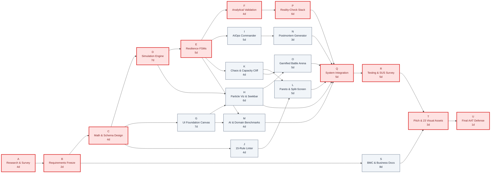

# Component 5: Network Diagram & Critical Path

**Course / Assessment:** Alternative Assessment Technique (AAT)  
**Theme:** Real-World Engineering Problem $\rightarrow$ Technically Feasible & Commercially Viable Solution  
**Project Title:** **CascadeLab — A Resilience Digital Twin & Chaos Simulation Platform for Distributed Microservices**  
**Team Size:** 4 Students (ISE / CSE)  

---

## 5.1 Project Activity Precedence Table

The complete engineering lifecycle of CascadeLab is mapped into **21 discrete activities (A through U)** with defined technical predecessors and estimated durations in working days (5-day work weeks, excluding weekends), incorporating all core queueing, Generative AI, AIOps, and executive telemetry modules:

| Activity ID | Activity Description | Assigned Owner | Duration ($D_i$) | Immediate Predecessors |
|---|---|---|---|---|
| **A** | Literature review, incident survey & competitor gap analysis | Nischay Kumar, Sthambaj | **4 Days** | — |
| **B** | Requirements specification, SMART objectives & scope freeze | Nischay Kumar | **2 Days** | A |
| **C** | Mathematical queueing formulation, Zod schema & UX design tokens | Nischay Kumar, Suchith N | **4 Days** | B |
| **D** | Discrete-time fluid simulation engine core ($dt=1.0\text{s}$, seeded Mulberry32) | Nischay Kumar | **7 Days** | C |
| **E** | Resilience mechanisms (Circuit Breakers, Bulkheads, Autoscalers, Crashes) | Nischay Kumar | **5 Days** | D |
| **F** | Simulator mathematical validation suite (Little's Law, Erlang-C, Conservation) | Nischay Kumar | **4 Days** | E |
| **G** | UI foundation (ReactFlow DAG canvas, Dagre auto-layout, node inspector) | Suchith N | **7 Days** | C |
| **H** | Real-time animated visualization (60 FPS particles, SVG Resilience Ring, Seekbar) | Suchith N | **6 Days** | D, G |
| **I** | AIOps Incident Commander (DEFCON 5-1 FSM, root-cause topological isolation) | Sthambaj | **5 Days** | E |
| **J** | 15-rule static architecture linter & graph articulation point (SPOF) analysis | Uday Kumar | **4 Days** | C |
| **K** | Chaos suite matrix runner, Capacity Cliff sweeper & resilience grading | Uday Kumar | **4 Days** | E |
| **L** | Multi-objective Pareto optimizer (NSGA-II Lite) & Split-Screen Replay | Uday Kumar | **5 Days** | J, K |
| **M** | Gemini 2.5 Flash AI Synthesizer, Offline Heuristics & 5 Domain Benchmarks | Suchith N, Sthambaj | **4 Days** | E, G |
| **N** | Automated postmortem incident report generator (Markdown & PDF export) | Uday Kumar, Sthambaj | **3 Days** | I |
| **O** | Gamified sandboxes (*Break It!* chaos attacker & *Defend It!* SRE battle HUD) | Sthambaj, Suchith N | **5 Days** | H, K |
| **P** | Dockerized 3-tier Node.js Reality-Check benchmark mini-stack & MAPE overlay | Sthambaj, Nischay Kumar | **6 Days** | F |
| **Q** | System-wide module integration, in-place GMV recalculator & visual polish | All 4 Members | **5 Days** | H, L, M, N, O, P |
| **R** | End-to-end testing, visual regression guard & usability evaluation (SUS) | Suchith N, Sthambaj | **5 Days** | Q |
| **S** | Comprehensive documentation (Business Model Canvas, Cost, Market, Risk) | Sthambaj, Uday Kumar | **8 Days** | B |
| **T** | Final presentation slide deck creation, 23 visual assets & pitch rehearsals | All 4 Members | **3 Days** | R, S |
| **U** | Final viva voce examination & entrepreneurial solution defense | All 4 Members | **1 Day** | T |

---

## 5.2 Activity-on-Node (AON) Network Diagram

The network diagram below illustrates task inter-dependencies. Activities highlighted in **red** constitute the **Critical Path** ($Total Float = 0$):

---

## 5.3 Critical Path Method (CPM) Calculations: Forward & Backward Pass

### Mathematical Formulation:
1. **Forward Pass (Early Schedule):**
   * Early Start ($ES$): $ES_i = \max_{p \in \text{Pred}(i)} (EF_p)$, with $ES_{\text{start}} = 0$.
   * Early Finish ($EF$): $EF_i = ES_i + D_i$.
2. **Backward Pass (Late Schedule):**
   * Late Finish ($LF$): $LF_i = \min_{s \in \text{Succ}(i)} (LS_s)$, with $LF_{\text{end}} = EF_{\text{end}}$.
   * Late Start ($LS$): $LS_i = LF_i - D_i$.
3. **Float Determination:**
   * Total Float ($TF$): $TF_i = LS_i - ES_i = LF_i - EF_i$. (Buffer before delaying total project duration).
   * Free Float ($FF$): $FF_i = \min_{s \in \text{Succ}(i)} (ES_s) - EF_i$. (Buffer before delaying immediate successor).
   * Critical Activity Condition: $TF_i = 0$.

### Forward and Backward Pass Master Table

| ID | Duration ($D_i$) | Early Start ($ES$) | Early Finish ($EF$) | Late Start ($LS$) | Late Finish ($LF$) | Total Float ($TF$) | Free Float ($FF$) | On Critical Path? |
|---|---|---|---|---|---|---|---|:---:|
| **A** | 4 | 0 | 4 | 0 | 4 | **0** | 0 | **YES (Critical)** |
| **B** | 2 | 4 | 6 | 4 | 6 | **0** | 0 | **YES (Critical)** |
| **C** | 4 | 6 | 10 | 6 | 10 | **0** | 0 | **YES (Critical)** |
| **D** | 7 | 10 | 17 | 10 | 17 | **0** | 0 | **YES (Critical)** |
| **E** | 5 | 17 | 22 | 17 | 22 | **0** | 0 | **YES (Critical)** |
| **F** | 4 | 22 | 26 | 22 | 26 | **0** | 0 | **YES (Critical)** |
| **G** | 7 | 10 | 17 | 19 | 26 | **9** | 0 | No |
| **H** | 6 | 17 | 23 | 26 | 32 | **9** | 3 | No |
| **I** | 5 | 22 | 27 | 24 | 29 | **2** | 0 | No |
| **J** | 4 | 10 | 14 | 23 | 27 | **13** | 12 | No |
| **K** | 4 | 22 | 26 | 23 | 27 | **1** | 0 | *Near-Critical* |
| **L** | 5 | 26 | 31 | 27 | 32 | **1** | 1 | *Near-Critical* |
| **M** | 4 | 22 | 26 | 28 | 32 | **6** | 6 | No |
| **N** | 3 | 27 | 30 | 29 | 32 | **2** | 2 | No |
| **O** | 5 | 26 | 31 | 27 | 32 | **1** | 1 | *Near-Critical* |
| **P** | 6 | 26 | 32 | 26 | 32 | **0** | 0 | **YES (Critical)** |
| **Q** | 5 | 32 | 37 | 32 | 37 | **0** | 0 | **YES (Critical)** |
| **R** | 5 | 37 | 42 | 37 | 42 | **0** | 0 | **YES (Critical)** |
| **S** | 8 | 6 | 14 | 34 | 42 | **28** | 28 | No |
| **T** | 3 | 42 | 45 | 42 | 45 | **0** | 0 | **YES (Critical)** |
| **U** | 1 | 45 | 46 | 45 | 46 | **0** | 0 | **YES (Critical)** |

---

## 5.4 Path Enumeration & Critical Path Identification

Across the entire network topology, exactly **9 independent execution paths** connect Project Start (Activity A) to Final Delivery (Activity U):

| Path Identifier | Sequence of Activities | Duration Calculation | Total Duration | Slack / Variance |
|---|---|---|---|---|
| **Path 1 (Critical)** | **A $\to$ B $\to$ C $\to$ D $\to$ E $\to$ F $\to$ P $\to$ Q $\to$ R $\to$ T $\to$ U** | **4 + 2 + 4 + 7 + 5 + 4 + 6 + 5 + 5 + 3 + 1** | **46 Days** | **0 Days (Critical Path)** |
| **Path 2** | A $\to$ B $\to$ C $\to$ D $\to$ E $\to$ K $\to$ L $\to$ Q $\to$ R $\to$ T $\to$ U | 4 + 2 + 4 + 7 + 5 + 4 + 5 + 5 + 5 + 3 + 1 | **45 Days** | +1 Day (Near-Critical) |
| **Path 3** | A $\to$ B $\to$ C $\to$ D $\to$ E $\to$ K $\to$ O $\to$ Q $\to$ R $\to$ T $\to$ U | 4 + 2 + 4 + 7 + 5 + 4 + 5 + 5 + 5 + 3 + 1 | **45 Days** | +1 Day (Near-Critical) |
| **Path 4** | A $\to$ B $\to$ C $\to$ D $\to$ E $\to$ I $\to$ N $\to$ Q $\to$ R $\to$ T $\to$ U | 4 + 2 + 4 + 7 + 5 + 5 + 3 + 5 + 5 + 3 + 1 | **44 Days** | +2 Days |
| **Path 5** | A $\to$ B $\to$ C $\to$ D $\to$ H $\to$ O $\to$ Q $\to$ R $\to$ T $\to$ U | 4 + 2 + 4 + 7 + 6 + 5 + 5 + 5 + 3 + 1 | **42 Days** | +4 Days |
| **Path 6** | A $\to$ B $\to$ C $\to$ D $\to$ E $\to$ M $\to$ Q $\to$ R $\to$ T $\to$ U | 4 + 2 + 4 + 7 + 5 + 4 + 5 + 5 + 3 + 1 | **40 Days** | +6 Days |
| **Path 7** | A $\to$ B $\to$ C $\to$ D $\to$ H $\to$ Q $\to$ R $\to$ T $\to$ U | 4 + 2 + 4 + 7 + 6 + 5 + 5 + 3 + 1 | **37 Days** | +9 Days |
| **Path 8** | A $\to$ B $\to$ C $\to$ J $\to$ L $\to$ Q $\to$ R $\to$ T $\to$ U | 4 + 2 + 4 + 4 + 5 + 5 + 5 + 3 + 1 | **33 Days** | +13 Days |
| **Path 9** | A $\to$ B $\to$ S $\to$ T $\to$ U | 4 + 2 + 8 + 3 + 1 | **18 Days** | +28 Days |

> [!IMPORTANT]
> **Key Schedule Conclusions:**
> 1. **Project Duration:** The minimum total time required to complete the project without slippage is **46 Working Days** ($\approx 9.2\text{ calendar weeks}$).
> 2. **The Backbone of Credibility:** The critical path runs strictly through the technical engine validation chain: **$\text{Engine (D)} \to \text{Mechanisms (E)} \to \text{Analytical Tests (F)} \to \text{Reality-Check Mini-Stack (P)}$**. Any delay in physical microservice benchmarking directly delays project completion.
> 3. **Near-Critical Paths (High Vigilance Required):** Paths 2 and 3 have only **1 day of total float**. Tasks **K** (Chaos Suite & Capacity Cliff), **L** (Auto-Harden Optimizer & Split-Screen), and **O** (Gamified Battle Arena) must be monitored with equal strictness to the critical path.
> 4. **Decoupled Workstreams:** Activity **G** (UI Foundation) has **9 days of float**, allowing the frontend team to develop the ReactFlow canvas using mocked simulation data while the engine core is being built. Activity **S** (Business & BMC Documentation) has **28 days of float**, allowing progressive asynchronous completion without schedule contention.

---

## 5.5 Presentation Slide Planning (Component 5 Deck)

For the final comprehensive presentation deck (Component 14), Component 5 will be presented across the following dedicated slides:

* **Slide 5.1 — Project Network Precedence Table:** Tabular listing of all 21 activities, durations, owners, and immediate predecessors.
* **Slide 5.2 — Complete AON Network Topology:** Full visual Activity-on-Node graph clearly distinguishing critical and non-critical nodes.
* **Slide 5.3 — Critical Path Mathematical Derivation:** Step-by-step presentation of Forward Pass ($ES/EF$) and Backward Pass ($LS/LF$) equations.
* **Slide 5.4 — Master CPM Schedule Table:** Full numerical table with Early/Late dates, Total Float ($TF$), Free Float ($FF$), and Critical Path flags.
* **Slide 5.5 — Path Enumeration & Slack Ranking:** Ranked comparison of all 9 paths highlighting the 46-day Critical Path and 45-day Near-Critical paths.
* **Slide 5.6 — Project Management Insights & Risk Mitigations:** Float management strategies, parallelization buffers, and critical path protection.

---

### Key Takeaways for the Final PPT Presentation

> [!TIP]
> **Summary for PPT Slide (Component 5):**
> * **21 Discrete Activities:** Fully mapped with rigorous technical predecessors and float calculations.
> * **46-Day Critical Path:** A $\to$ B $\to$ C $\to$ D $\to$ E $\to$ F $\to$ P $\to$ Q $\to$ R $\to$ T $\to$ U. Validating the queueing engine against the Docker Reality-Check stack represents the pacing item.
> * **Zero Slippage:** Near-critical paths monitored with 1-day float guards; decoupled frontend and business workstreams ensure zero pipeline contention.
