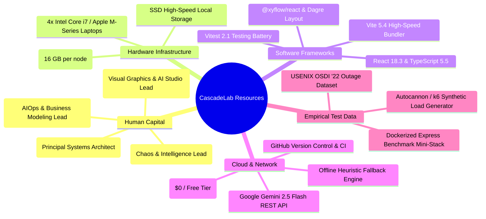
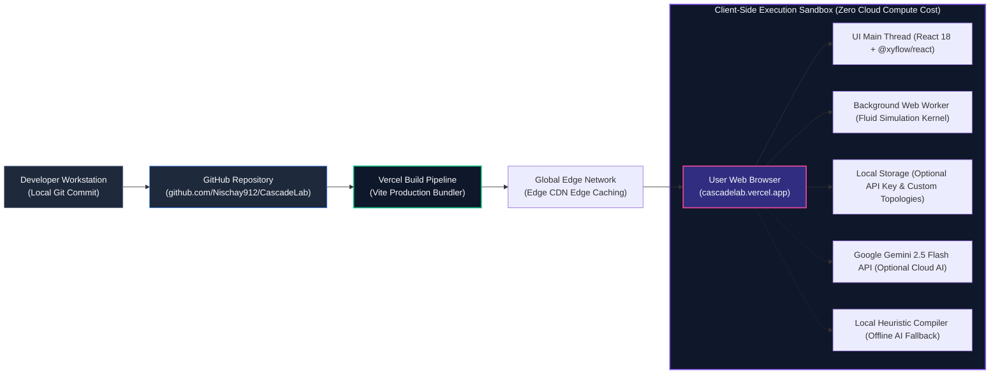

# Component 7: Resource Requirements

**Course / Assessment:** Alternative Assessment Technique (AAT)  
**Theme:** Real-World Engineering Problem $\rightarrow$ Technically Feasible & Commercially Viable Solution  
**Project Title:** **CascadeLab — A Resilience Digital Twin & Chaos Simulation Platform for Distributed Microservices**  
**Team Size:** 4 Students (ISE / CSE)  

---

## 7.1 Comprehensive Resource Requirements Matrix

To engineer, validate, and deliver CascadeLab without incurring financial debt, resources were optimized across human, hardware, software, cloud, and empirical benchmark categories:



| Category | Item Description | Specification / Version | Engineering Role & Justification | Cost (Academic Phase) |
|---|---|---|---|:---:|
| **Human** | Principal Systems Architect | Lead: **Nischay Kumar** | Mathematical queueing engine, Web Worker fluid kernel, Zod schema, live financial loss telemetry. | ₹0 (Student Effort) |
| **Human** | Frontend & AI Graphics Lead | Lead: **Suchith N** | `@xyflow/react` canvas, custom SVG shaders, Gemini AI Prompt Studio, 180s seekbar scrubber. | ₹0 (Student Effort) |
| **Human** | Chaos & Intelligence Lead | Lead: **Uday Kumar** | 15-rule static linter, Pareto multi-objective optimizer, Capacity Cliff sweeper, postmortem PDF generator. | ₹0 (Student Effort) |
| **Human** | AIOps & Business Lead | Lead: **Sthambaj** | AIOps Incident Commander (DEFCON FSM), *Break It!*/*Defend It!* sandboxes, Docker test bench, BMC & market research. | ₹0 (Student Effort) |
| **Hardware** | Engineering Workstations | 4x Laptops (16GB RAM, SSD) | Local TypeScript compilation, Web Worker stress testing, Docker container execution. | Existing University HW |
| **Software** | Core Framework | React 18.3.1 + TypeScript 5.5 | Type-safe stateful UI components, high-speed DOM updates, zero runtime type errors. | Open Source (MIT) |
| **Software** | Build Tooling | Vite 5.4.2 | Sub-second Hot Module Replacement (HMR) and optimized browser production packaging. | Open Source (MIT) |
| **Software** | Graph Visualization | `@xyflow/react` 12.3.5 | GPU-accelerated interactive node graph, zoom/pan controls, custom SVG node & edge renderers. | Open Source (MIT) |
| **Software** | Graph Auto-Layout | Dagre 0.8.5 | Automatic directed acyclic graph (DAG) topological positioning with collision avoidance. | Open Source (MIT) |
| **Software** | Generative AI API | Google Gemini 2.5 Flash | Structured JSON schema compilation converting natural language prompts into topology graphs. | Free Tier / Optional |
| **Software** | Offline AI Heuristics | Built-in Heuristic Compiler | Zero-external-dependency regex parser providing guaranteed fallback when no API key exists. | Proprietary TypeScript |
| **Software** | State Management | Zustand 4.5.5 | Atomic reactive state management decoupled from UI rendering cycles for maximum FPS. | Open Source (MIT) |
| **Software** | PDF Document Engine | jsPDF 2.5.2 + autoTable | Automated client-side generation of SRE-grade incident postmortem PDF reports. | Open Source (MIT) |
| **Software** | Unit Testing Suite | Vitest 2.1.2 | High-speed unit testing verifying queueing math, PRNG reproducibility, and linter rules. | Open Source (MIT) |
| **Cloud** | Global Hosting | Vercel Edge Network | Serverless edge deployment of static assets with worldwide low-latency caching (`cascadelab.vercel.app`). | ₹0 (Hobby Free Tier) |
| **Cloud** | Code Repository | GitHub | Git version control, collaborative branch reviews, issue tracking, and automated CI triggers. | ₹0 (Free Tier) |
| **Data** | Empirical Benchmark | Dockerized 3-tier Stack | Express.js microservices running with Autocannon load generators for physical MAPE validation. | Open Source / Local |

---

## 7.2 Team Module Ownership & Codebase Allocation

To ensure strict accountability and seamless parallel development, the codebase is partitioned into distinct module ownership zones:

```
┌────────────────────────────────────────────────────────────────────────────────────────┐
│                      CASCADELAB TEAM CODEBASE OWNERSHIP MAP                            │
├──────────────────┬─────────────────────────────┬───────────────────────────────────────┤
│ TEAM MEMBER      │ ROLE TITLE                  │ PRIMARY CODEBASE DIRECTORIES          │
├──────────────────┼─────────────────────────────┼───────────────────────────────────────┤
│ Nischay Kumar    │ Principal Systems Architect │ • src/sim/ (engine, math, worker, PRNG│
│                  │                             │ • src/schema/ (architecture, zod)     │
│                  │                             │ • src/ui/TopNav.tsx (financial loss)  │
├──────────────────┼─────────────────────────────┼───────────────────────────────────────┤
│ Suchith N        │ Frontend & Visual Graphics  │ • src/viz/ (graph, shaders, particles)│
│                  │ Lead                        │ • src/generator/ (Gemini AI studio)   │
│                  │                             │ • src/ui/BottomTimeline.tsx (seekbar) │
│                  │                             │ • src/ui/ResilienceRing.tsx (SVG ring)│
├──────────────────┼─────────────────────────────┼───────────────────────────────────────┤
│ Uday Kumar       │ Chaos & Intelligence Lead   │ • src/lint/ (15 static rules, linter) │
│                  │                             │ • src/optimizer/ (Pareto, split-screen│
│                  │                             │ • src/chaos/ (Capacity cliff, matrix) │
│                  │                             │ • src/postmortem/ (PDF / Markdown)    │
├──────────────────┼─────────────────────────────┼───────────────────────────────────────┤
│ Sthambaj         │ AIOps, QA & Business Lead   │ • src/commander/ (DEFCON incident FSM)│
│                  │                             │ • src/demo/ (Break It! / Defend It!)  │
│                  │                             │ • src/reality/ (Docker MAPE bench)    │
│                  │                             │ • Business Model Canvas & Risk Docs   │
└──────────────────┴─────────────────────────────┴───────────────────────────────────────┘
```

---

## 7.3 Infrastructure & Hosting Topology

CascadeLab is deployed to global production using a **modern zero-cost serverless architecture**:



1. **Zero Recurring Server Compute Costs:** Unlike traditional chaos platforms that require maintaining Kubernetes clusters 24/7 on AWS/GCP (costing ₹15,000–₹40,000/month), CascadeLab's entire simulation and analysis execute on the client's local CPU via Web Workers.
2. **API Key Security & Privacy:** Visitors can run CascadeLab immediately with zero setup using the built-in heuristic compiler. If they provide a Google Gemini API key to access 2.5 Flash generative capabilities, the key is stored strictly in the user's browser `localStorage` and never transmitted to any intermediary backend.
3. **High-Availability Edge Distribution:** Production builds are deployed on Vercel's edge network (`cascadelab.vercel.app`), guaranteeing sub-second load times globally, instant SSL termination, and $99.99\%$ platform availability at ₹0 hosting cost.

---

## 7.4 Presentation Slide Planning (Component 7 Deck)

For the final comprehensive presentation deck (Component 14), Component 7 will be presented across the following dedicated slides:

* **Slide 7.1 — Comprehensive Resource Requirements Matrix:** Full overview of human roles, hardware workstations, software libraries, and cloud infrastructure.
* **Slide 7.2 — Codebase Ownership & Specialization:** Clear distribution of modules across the 4 team members showing accountability.
* **Slide 7.3 — Client-Side Serverless Hosting Architecture:** Explanation of how Web Workers and Vercel edge deployment achieve a ₹0 operating cost while delivering enterprise-grade performance.

---

### Key Takeaways for the Final PPT Presentation

> [!TIP]
> **Summary for PPT Slide (Component 7):**
> * **Zero Direct Cash Cost:** Leveraged modern open-source web technologies, Vercel free-tier edge hosting, and client-side compute.
> * **100% Client-Side Privacy:** All simulation executes in browser Web Workers; API keys remain strictly in local browser storage.
> * **Balanced Team Ownership:** Granular partitioning of codebase responsibilities across queueing math, UI graphics, chaos intelligence, and AIOps automation.
