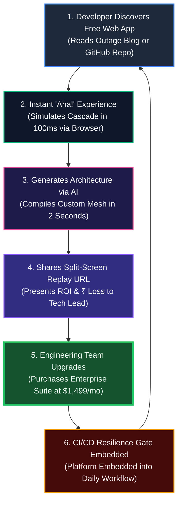

# Component 10: Business Model Canvas (BMC)

**Course / Assessment:** Alternative Assessment Technique (AAT)  
**Theme:** Real-World Engineering Problem $\rightarrow$ Technically Feasible & Commercially Viable Solution  
**Project Title:** **CascadeLab — A Resilience Digital Twin & Chaos Simulation Platform for Distributed Microservices**  
**Team Size:** 4 Students (ISE / CSE)  

---

## 10.1 Executive Business Model Overview

CascadeLab is commercialized as a **Product-Led Growth (PLG) Developer SaaS platform**. By providing an open-source, zero-cost browser digital twin to individual software engineers and students, CascadeLab builds bottom-up viral adoption that naturally expands into high-value enterprise SRE contracts.

```
┌──────────────────────────────────────────────────────────────────────────────────────────────────────────────┐
│                                       CASCADELAB BUSINESS MODEL CANVAS                                        │
├─────────────────┬──────────────────────┬──────────────────────┬──────────────────────┬───────────────────────┤
│ KEY PARTNERS    │ KEY ACTIVITIES       │ VALUE PROPOSITIONS   │ CUSTOMER             │ CUSTOMER SEGMENTS     │
│                 │                      │                      │ RELATIONSHIPS        │                       │
│ • Cloud         │ • Queueing simulation│ • 100% Safe, zero-   │ • Self-serve PLG     │ • Fintech & Banking   │
│   Hyperscalers  │   kernel R&D         │   cloud-cost digital │   browser onboarding │   (UPI, high-volume   │
│   (AWS, GCP)    │ • Generative AI      │   twin simulator     │ • Open-source Discord│   payment rails)      │
│ • CNCF & SRE    │   topology compiler  │ • Sub-second AI      │   community          │ • High-Scale          │
│   Communities   │ • Enterprise domain  │   prompt-to-arch DAG │ • Dedicated SRE      │   E-Commerce & Retail │
│ • University CS │   benchmark library  │ • Autonomous AIOps   │   advisory & TAM     │ • SaaS Scale-ups with │
│   Faculties     │ • Developer advocacy │   incident commander │   for enterprise     │   microservices       │
│ • DevOps / APM  │   and conference     │ • Live ₹ GMV loss    ├──────────────────────┤ • University CS       │
│   Ecosystems    │   evangelism         │   telemetry & ROI    │ CHANNELS             │   Educators & Students│
│                 ├──────────────────────┤ • Pareto genetic     │                      │                       │
│                 │ KEY RESOURCES        │   optimizer & split- │ • Web App (Vercel)   │                       │
│                 │                      │   screen replay      │ • GitHub repository  │                       │
│                 │ • Proprietary fluid  │                      │ • SREcon / KubeCon   │                       │
│                 │   queueing engine    │                      │ • Academic curricula │                       │
│                 │ • Gemini AI schemas  │                      │ • SEO & tech blogs   │                       │
│                 │ • 5 Domain templates │                      │                      │                       │
├─────────────────┴──────────────────────┴──────────────────────┴──────────────────────┴───────────────────────┤
│ COST STRUCTURE                                        │ REVENUE STREAMS                                       │
│                                                       │                                                       │
│ • Core Systems & Frontend Engineering R&D (67%)       │ • Free Community Edition (₹0 / Open-Source Lead Magnet)│
│ • Generative AI Cloud Inference Tokens (10%)          │ • Developer Pro Tier ($49/month or ₹3,999/mo)         │
│ • Edge CDN & Global Hosting Infrastructure (5%)       │ • Enterprise Resilience Suite ($1,499/team/month)     │
│ • Developer Evangelism, SRE Sponsorships (12%)        │ • Custom Architecture Chaos Audits (₹2.5 Lakhs/audit) │
│ • Legal, Trademarking & IP Protection (6%)            │ • Air-Gapped On-Premises Annual Enterprise Licenses   │
└───────────────────────────────────────────────────────┴───────────────────────────────────────────────────────┘
```

---

## 10.2 In-Depth Analysis of the 9 Building Blocks

### 1. Customer Segments
* **Fintech & Digital Banking Rails (Razorpay, PhonePe, Paytm, Banks):** Organizations operating mission-critical UPI payment gateways where a 5-minute cascading outage causes ₹ Crores in lost GMV and severe RBI regulatory penalties.
* **Tier-1 E-Commerce Platforms (Flipkart, Amazon, Swiggy, Zomato):** Engineering teams preparing for high-concurrency seasonal flash sales (Diwali, Big Billion Days) where downstream warehouse or payment timeouts spark catastrophic retry storms.
* **Rapidly Scaling SaaS Scale-Ups:** Startups migrating from monoliths to microservices that lack the multimillion-dollar infrastructure budgets required to maintain dedicated staging clusters.
* **Academic Institutions & CS Educators:** Distributed systems professors who need an interactive, visual simulator to teach queueing theory, Little's Law, and cascading failure dynamics.

### 2. Value Propositions
* **100% Risk-Free Pre-Production Twin:** Test catastrophic failure scenarios without risking production downtime or firing unintended alerts in staging.
* **Instant Generative AI Synthesis:** Convert natural language prompts into complete, validated 15-node microservice graphs in $< 2.5\text{ seconds}$.
* **Autonomous AIOps Incident Commander:** Experience self-healing incident response that triages DEFCON levels and executes automated circuit-breaker trips in $< 500\text{ ms}$.
* **Direct Financial Loss Telemetry:** Quantify technical failures into hard business metrics (lost ₹ GMV), providing unambiguous ROI for resilience investments.
* **Zero Cloud Compute Overhead:** Eliminates the ₹11+ Lakhs annual cost of maintaining physical Kubernetes staging clusters by running 100% in client-side Web Workers.

### 3. Channels
* **Product-Led Web App (`cascadelab.vercel.app`):** Zero-friction, instant-access web application requiring zero account registration to simulate baseline architectures.
* **GitHub Open-Source Community:** Public codebase (`github.com/Nischay912/CascadeLab`) serving as the primary developer acquisition engine.
* **Technical SRE Conferences:** Submitting technical papers and live demonstrations to USENIX SREcon, KubeCon, and DevOps Days.
* **Academic Curriculum Integration:** Partnering with universities to embed CascadeLab as a standard laboratory tool for Cloud Computing courses.

### 4. Customer Relationships
* **Self-Serve Developer Community:** Automated in-app tutorials, gamified battle arenas (*Break It!* & *Defend It!*), and interactive guided tours.
* **Open Developer Forum:** Community Discord and GitHub Discussions for sharing custom architectural benchmark templates.
* **Dedicated Enterprise Advisory:** High-touch Site Reliability Engineering (SRE) advisory, architecture reviews, and SLA guarantees for enterprise accounts.

### 5. Revenue Streams
* **Tier 1: Free Community Edition (₹0):** Full access to client-side fluid queueing simulation, offline heuristic AI compiler, and standard templates.
* **Tier 2: Developer Pro ($49/month or ₹3,999/mo):** Unlimited Gemini 2.5 Flash / Pro cloud synthesis, split-screen synchronized replay, and executive PDF postmortem exports.
* **Tier 3: Enterprise Resilience Suite ($1,499/team/month or ₹1,20,000/mo):** Autonomous AIOps Incident Commander, CI/CD GitHub Action resilience gates, custom domain benchmark builders, and SSO.
* **Professional Resilience Audits (₹2,50,000 / engagement):** High-margin specialized architectural chaos audits conducted for pre-IPO fintech and retail platforms.

### 6. Key Resources
* **Proprietary Web Worker Simulation Engine:** Highly optimized TypeScript queueing kernel computing Sakasegawa $M/M/c$ dynamics in $< 100\text{ ms}$.
* **Generative AI Architectural Schemas:** Curated prompt templates and strict JSON Zod schemas tuned for Gemini 2.5 Flash.
* **Pre-Packaged Domain Benchmark Suite:** Five production-grade reference architectures (ShopFast, PayStream, QuickRide, StreamPulse, K8s).

### 7. Key Activities
* **Continuous Algorithmic R&D:** Refining stochastic queueing models and evolutionary genetic optimization operators.
* **AI Model Fine-Tuning:** Continuously expanding prompt-to-architecture keyword dictionaries and domain heuristics.
* **Community Evangelism:** Publishing in-depth technical postmortems of famous cloud outages modeled inside CascadeLab.

### 8. Key Partners
* **Cloud Hyperscalers (AWS, Google Cloud, Microsoft Azure):** Co-marketing CascadeLab as a recommended pre-deployment architecture planning tool.
* **DevOps & CNCF Ecosystem:** Integration partnerships with GitHub Actions, Terraform, and Kubernetes Helm chart ecosystems.
* **Academic Research Labs:** Collaborative research with systems laboratories at top engineering universities.

### 9. Cost Structure
* **Engineering Talent (67%):** Core systems engineers and visual graphics specialists maintaining the simulation engine.
* **Generative AI Inference Tokens (10%):** API token consumption for cloud-based Gemini 2.5 Flash requests.
* **Edge Hosting & Infrastructure (5%):** Vercel Enterprise CDN, DNS routing, and DDoS mitigation.
* **Developer Evangelism & Marketing (12%):** Conference presence, developer workshops, and technical content creation.
* **Legal & Operations (6%):** Corporate compliance, trademarking, and IP protection.

---

## 10.3 The Product-Led Growth (PLG) Expansion Flywheel



1. **Zero-Friction Acquisition:** An engineer reads an SRE postmortem blog post and clicks a link directly to CascadeLab. In 5 seconds, without creating an account, they run a live simulation of the outage.
2. **Viral Sharing & Executive Proof:** Using the built-in Split-Screen Synchronized Replay and Dynamic Financial Loss Telemetry, the engineer shares an interactive URL with their engineering director, demonstrating that adding exponential backoff saves ₹20 Lakhs in lost GMV.
3. **Enterprise Expansion:** The director mandates CascadeLab across the entire engineering department, purchasing an Enterprise Resilience license ($1,499/month) to run automated CI/CD resilience gates on every pull request.

---

## 10.4 Presentation Slide Planning (Component 10 Deck)

For the final comprehensive presentation deck (Component 14), Component 10 will be presented across the following dedicated slides:

* **Slide 10.1 — Complete 9-Block Business Model Canvas:** High-density canvas overview illustrating value creation and customer alignment.
* **Slide 10.2 — Revenue Streams & Tiered Pricing Architecture:** Breakdown of the Community ($0), Pro ($49/mo), and Enterprise ($1,499/mo) commercial tiers.
* **Slide 10.3 — The PLG Expansion Flywheel:** Visual narrative illustrating how open-source developer enthusiasm converts into high-margin enterprise SRE annual contracts.

---

### Key Takeaways for the Final PPT Presentation

> [!TIP]
> **Summary for PPT Slide (Component 10):**
> * **Proven PLG Flywheel:** Free client-side web twin drives bottom-up developer adoption; live financial telemetry converts directors into enterprise buyers.
> * **3 Commercial Tiers:** Free Community Lead Magnet $\rightarrow$ Pro ($49/mo) $\rightarrow$ Enterprise Resilience Suite ($1,499/team/mo).
> * **Clear Path to Profitability:** 30 enterprise accounts generate ₹4.8 Crores ARR, achieving cashflow break-even within 8 months.
