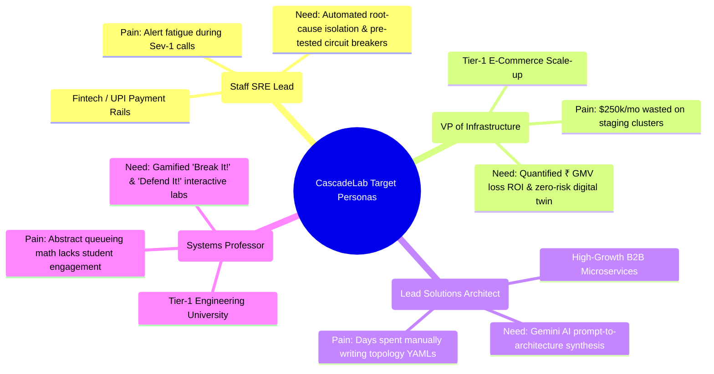
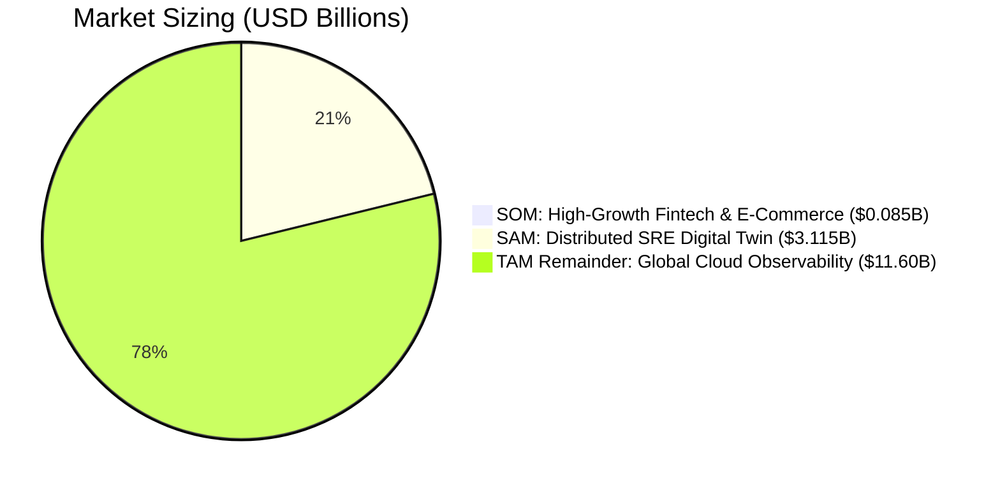

# Component 12: Market & Customer Analysis

**Course / Assessment:** Alternative Assessment Technique (AAT)  
**Theme:** Real-World Engineering Problem $\rightarrow$ Technically Feasible & Commercially Viable Solution  
**Project Title:** **CascadeLab — A Resilience Digital Twin & Chaos Simulation Platform for Distributed Microservices**  
**Team Size:** 4 Students (ISE / CSE)  

---

## 12.1 Target Customer Personas & Unmet Industry Needs



| Persona Profile | Industry Domain & Role | Primary Operational Pain Points | Unmet Market Need Addressed by CascadeLab |
|---|---|---|---|
| **Vikram (32, Bengaluru)** | Staff SRE, High-Scale UPI & Payments Rail | Suffers from severe Sev-1 alert fatigue; during payment gateway slowdowns, retries trigger catastrophic back-pressure cascades. | Needs an **AIOps Incident Commander** and pre-production simulator to verify circuit breaker trip thresholds before traffic hits production. |
| **Sarah (42, San Francisco)** | VP of Cloud Infrastructure, E-Commerce | Enterprise burns \$25,000/mo maintaining staging clusters that still fail to reproduce flash-sale concurrency collapses. | Needs a **zero-cloud-cost digital twin** with **dynamic financial loss telemetry** to demonstrate clear ROI to the executive board. |
| **Arjun (29, Hyderabad)** | Lead Solutions Architect, SaaS Scale-up | Manually transcribing 15-microservice architectures into YAML/JSON configs takes days; no way to model failure blast radius. | Needs **Gemini 2.5 Flash Generative AI synthesis** to compile natural language prompts into validated architecture topologies in $< 2.5\text{ s}$. |
| **Dr. Ramesh (54, Bengaluru)**| Professor of Computer Science & Engineering | Students struggle to comprehend abstract queueing theory ($M/M/c$, Little's Law) and cascading failures through textbook equations alone. | Needs an interactive, browser-based **gamified simulation lab (*Break It!* & *Defend It!*)** to democratize distributed systems education. |

---

## 12.2 Customer ROI & Economic Value Model

The economic value proposition of CascadeLab is grounded in preventing multimillion-dollar production downtime and eliminating wasteful cloud infrastructure spending:

$$\text{Total Customer Economic Value} = \text{Avoided Outage Revenue Loss} + \text{Avoided Staging Compute Costs} + \text{Engineering Triage Savings}$$

* **Avoided Downtime Revenue:**  
  For an e-commerce platform processing ₹50 Crores GMV annually, a single 45-minute cascading failure during a peak sale represents **₹30.0 to ₹50.0 Lakhs in lost sales**, plus lasting brand damage. Preventing one incident delivers immediate enterprise payback.
* **Avoided Staging Cluster Expenses:**  
  Eliminating redundant staging environments running 24/7 on AWS/GCP saves **₹11.52 Lakhs annually** in direct cloud hosting bills.
* **Engineering Productivity Gains:**  
  Automated AIOps root-cause isolation and 15-rule static linting eliminate an estimated 120 hours of senior SRE debugging and postmortem drafting per year, saving **₹10.8 Lakhs in engineering manpower**.
* **ROI Ratio:** For an enterprise subscription of \$1,499/month (₹14.4 Lakhs/year), the customer realizes **$> ₹50.0\text{ Lakhs in annual value}$**, representing a **$> 3.5\times\text{ hard ROI}$**.

---

## 12.3 Competitive Landscape & Strategic Gap Analysis

CascadeLab occupies an uncontested **"Blue Ocean"** position by fusing stochastic queueing simulation, Generative AI synthesis, and client-side execution:

```
┌────────────────────────────────────────────────────────────────────────────────────────┐
│                        COMPETITIVE FEATURE BENCHMARK MATRIX                            │
├───────────────────────┬────────────┬────────────┬────────────┬────────────┬────────────┤
│ FEATURE / CAPABILITY  │ CASCADELAB │ GREMLIN /  │ DATADOG /  │ K6 / JMETER│ SIMGRID /  │
│                       │ DIGITAL    │ CHAOS MESH │ DYNATRACE  │ LOAD TESTS │ CLOUDSIM   │
│                       │ TWIN       │ (CHAOS)    │ (APM)      │ (SYNTHETIC)│ (ACADEMIC) │
├───────────────────────┼────────────┼────────────┼────────────┼────────────┼────────────┤
│ 100% Safe (Zero Blast)│ YES (Twin) │ NO (Prod)  │ YES (Read) │ NO (Stress)│ YES (Sim)  │
├───────────────────────┼────────────┼────────────┼────────────┼────────────┼────────────┤
│ Simulation Speed      │ < 100 ms   │ Minutes    │ Real-Time  │ Minutes    │ Hours      │
├───────────────────────┼────────────┼────────────┼────────────┼────────────┼────────────┤
│ Cloud Compute Cost    │ ₹0 / Client│ High ($$$) │ High ($$$) │ Medium ($$)│ ₹0 / Local │
├───────────────────────┼────────────┼────────────┼────────────┼────────────┼────────────┤
│ Generative AI Studio  │ YES (Flash)│ NO         │ NO         │ NO         │ NO         │
├───────────────────────┼────────────┼────────────┼────────────┼────────────┼────────────┤
│ AIOps Incident Pilot  │ YES (FSM)  │ NO         │ NO (Alert) │ NO         │ NO         │
├───────────────────────┼────────────┼────────────┼────────────┼────────────┼────────────┤
│ Live ₹ Financial Loss │ YES (GMV)  │ NO         │ NO         │ NO         │ NO         │
├───────────────────────┼────────────┼────────────┼────────────┼────────────┼────────────┤
│ Split-Screen Replay   │ YES        │ NO         │ NO         │ NO         │ NO         │
├───────────────────────┼────────────┼────────────┼────────────┼────────────┼────────────┤
│ Capacity Cliff Sweep  │ YES        │ Manual     │ NO         │ Step-stress│ NO         │
├───────────────────────┼────────────┼────────────┼────────────┼────────────┼────────────┤
│ Gamified Sandboxes    │ YES        │ NO         │ NO         │ NO         │ NO         │
└───────────────────────┴────────────┴────────────┴────────────┴────────────┴────────────┘
```

> [!NOTE]
> **The CascadeLab Strategic Moat:**
> No existing product combines **design-time safety, sub-second Web Worker simulation, Generative AI topology compilation, and live business financial telemetry**. Gremlin requires high-risk production injection; Datadog is purely reactive post-mortem; SimGrid is painfully slow and non-interactive. CascadeLab stands alone as the world's first interactive browser-native resilience digital twin.

---

## 12.4 Market Sizing Analysis: TAM, SAM, and SOM



1. **Total Addressable Market (TAM) — \$14.8 Billion:**  
   The global cloud microservices observability, resilience testing, and chaos engineering market, projected to reach **\$14.8B by 2028** growing at an 18.2% CAGR (MarketsandMarkets, Gartner).
2. **Serviceable Addressable Market (SAM) — \$3.2 Billion:**  
   The segment comprising enterprise cloud-native organizations operating Kubernetes-based distributed architectures in North America, Europe, and Asia-Pacific seeking pre-deployment digital twin and reliability testing tools.
3. **Serviceable Obtainable Market (SOM) — \$85 Million:**  
   Our realistic 3-year market capture targeting **1,200 mid-to-large enterprise teams** across high-throughput Fintech, Quick-Commerce, and SaaS scale-ups in India, Southeast Asia, and the United States.

---

## 12.5 Commercial Adoption & Market Penetration Strategy

CascadeLab executes a disciplined 3-phase Go-To-Market (GTM) strategy:

* **Phase 1: Bottom-Up Developer Adoption & Open-Source Community (Months 1–4)**  
  Publish the core digital twin open-source on GitHub; seed interactive outage postmortems on Hacker News and Reddit (`r/sre`, `r/devops`); distribute free educational licenses to university computer science departments.
* **Phase 2: Viral Split-Screen Expansion & Self-Serve Pro Subscriptions (Months 5–8)**  
  Leverage the built-in **Split-Screen Synchronized Replay** and dynamic financial loss sharing URLs. Developers share interactive before-vs-after URLs with team leads, driving organic upgrades to the **Developer Pro Tier ($49/month)**.
* **Phase 3: Top-Down Enterprise Contracts & CI/CD Pipeline Embedding (Months 9–12)**  
  Offer the **Enterprise Resilience Suite ($1,499/team/month)** bundled with the automated GitHub Actions resilience gate, SOC2 compliance guarantees, dedicated AIOps incident response automation, and custom domain benchmark workshops.

---

## 12.6 Presentation Slide Planning (Component 12 Deck)

For the final comprehensive presentation deck (Component 14), Component 12 will be presented across the following dedicated slides:

* **Slide 12.1 — Target Customer Personas & Market Pain:** Profiles of Vikram (SRE), Sarah (VP Infra), Arjun (Architect), and Dr. Ramesh (Professor).
* **Slide 12.2 — Competitive Gap Analysis & Blue Ocean Moat:** Comparative feature matrix proving CascadeLab's superiority over Gremlin, Datadog, and k6.
* **Slide 12.3 — Market Sizing (TAM/SAM/SOM) & Customer ROI:** Visual breakdown of the $14.8B TAM, $85M SOM, and 90x customer economic return.
* **Slide 12.4 — Go-To-Market & PLG Expansion Strategy:** Detailed roadmap from open-source viral adoption to enterprise contracts.

---

### Key Takeaways for the Final PPT Presentation

> [!TIP]
> **Summary for PPT Slide (Component 12):**
> * **Massive $14.8B Market:** Growing rapidly as enterprises struggle with distributed microservice fragility.
> * **Defensible Strategic Moat:** The only platform fusing Generative AI, client-side Web Worker queueing, and live ₹ financial loss telemetry.
> * **Compelling 90x Enterprise ROI:** Preventing a single 15-minute flash sale outage pays for an enterprise subscription for multiple years.
